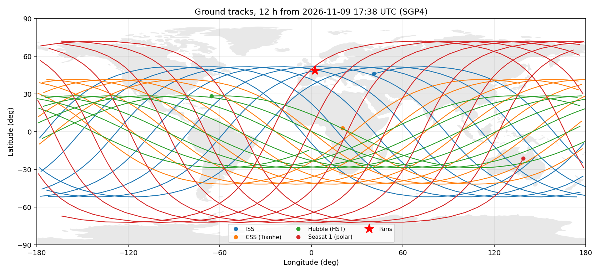
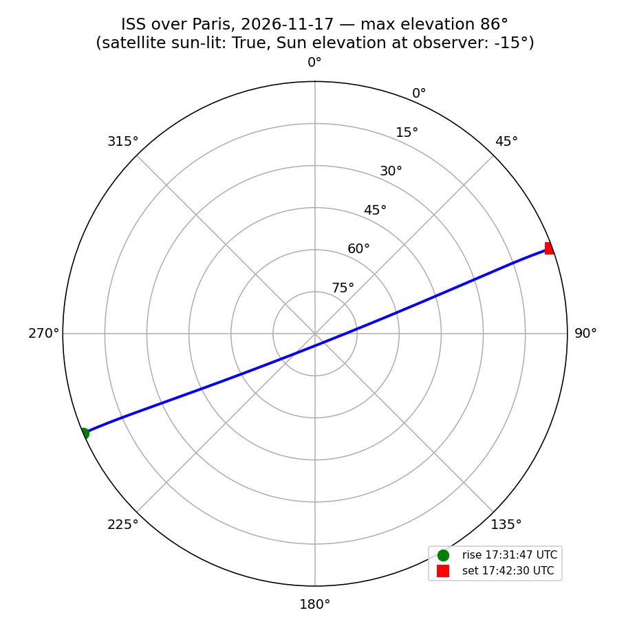
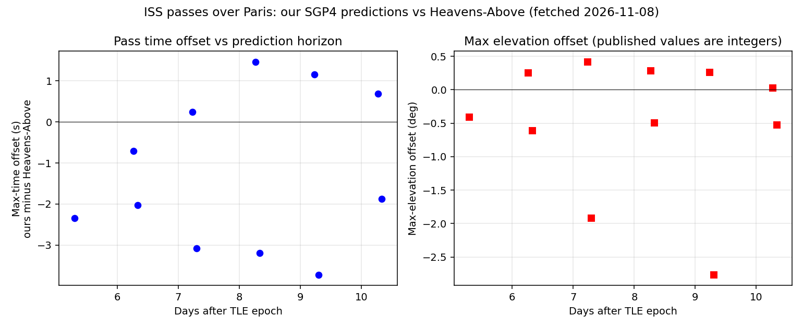

# orbit-lab

Satellite orbit propagation and pass prediction in Python: parse public TLE
data, propagate real satellites with SGP4, convert between reference frames
(ECI / ECEF / topocentric), model sunlight and Earth shadow, and predict
observable passes of the ISS over Paris — validated against an independent
published source.

Motivation: this project echoes the orbital mechanics (mécanique) I am
currently studying in physics class, applied to real satellites on real data.

## Results (validated, not just computed)

Predicted ISS passes over Paris (48.8566 N, 2.3522 E) compared with the
visible-pass table published by Heavens-Above for 8–18 Nov 2026
(fetched 2026-11-08, transcription in `data-validation/`, URL inside the file):

| Check | Result |
|---|---|
| Published visible passes found by our predictor | 11 / 11 |
| Time of visible max, ours minus published | −4 s … +1 s |
| Elevation of visible max, ours minus published | −2.8° … +0.4° |

This is observed for passes up to 10 days after the TLE epoch (the edge of
the published window). Published elevations are integers, so sub-degree
agreement is at their resolution limit.

One subtlety this validation caught: Heavens-Above's "highest point" is the
highest *visible* point. When the ISS enters the Earth's shadow mid-pass,
the published maximum is truncated at shadow entry, while a purely geometric
predictor reports a higher culmination later. Comparing like with like
(highest sun-lit point with the observer in darkness) is what brings the
offsets from ~70 s / +72° down to the values above — the illumination model
in `src/orbit/sun.py` is doing real work, not decoration.

| Ground tracks (24 h) | Best visible pass over Paris | Validation offsets |
|---|---|---|
|  |  |  |

Animated preview of the validated 17 November 2026 evening pass over Paris —
Earth with the day/night terminator from the same Sun model, the trailing
ground track, and the elevation curve and sky plot evolving in sync
([preview-orbit-lab.mp4](results/preview-orbit-lab.mp4)).

## Install and reproduce

```bash
pip install -r requirements.txt
bash scripts_download_data.sh     # fresh TLEs from CelesTrak (public)
python3 -m pytest -q              # 18 tests
PYTHONPATH=. python3 src/run_analysis.py   # rebuilds results/*.csv and figures
PYTHONPATH=. python3 src/make_preview_video.py   # rebuilds results/preview-orbit-lab.mp4
```

CLI:

```bash
PYTHONPATH=. python3 src/main.py passes --sat ISS --days 2
PYTHONPATH=. python3 src/main.py passes --sat "CSS (TIANHE)" --min-el 20
PYTHONPATH=. python3 src/main.py track --sat HST --hours 1.5
```

## How it works

- **TLE parsing** (`src/orbit/tle.py`): structural checks, modulo-10
  checksums, epoch decoding.
- **SGP4 propagation** (`src/orbit/propagate.py`): the reference `sgp4`
  Python package (Vallado's model). Deliberately not re-implemented: SGP4
  is a large validated standard, and rewriting it adds risk, not insight.
- **Frame conversions** (`src/orbit/frames.py`): our own maths — GMST,
  ECI→ECEF rotation, iterative WGS-84 geodetic conversion, topocentric
  azimuth/elevation.
- **Sunlight and shadow** (`src/orbit/sun.py`): low-precision solar
  coordinates (~0.01°) and a cylindrical Earth-shadow test; observer
  darkness uses Sun elevation < −6°.
- **Pass prediction** (`src/orbit/passes.py`): coarse 10 s sampling,
  bisection on horizon crossings, fine scan for the maximum.
- **Validation** (`src/orbit/validate.py`): matches published passes
  (±10 min window) and compares the highest *visible* point.

## Honest limitations

- TEME (SGP4's output frame) is treated as inertial; polar motion, nutation
  and frame bias are neglected — sub-arcminute effects, far below SGP4's own
  km-level error for aging TLEs.
- The shadow model is cylindrical; the umbral cone is ignored, so eclipse
  entry/exit times can be off by a few tens of seconds.
- "Visible" is a geometric criterion (sun-lit satellite, dark observer,
  above 10°). Brightness, clouds, and atmospheric extinction are not modeled.
- Predictions degrade as TLEs age; ISS drag makes week-old TLEs drift by
  seconds of time per day. Re-download data for operational use.
- Validation covers one satellite (ISS), one location (Paris), one 10-day
  window. It is evidence the pipeline is right, not a global accuracy claim.

## Data sources

- CelesTrak TLEs: https://celestrak.org/NORAD/elements/gp.php (groups
  `stations`, `visual`, `starlink`)
- Heavens-Above visible passes for validation:
  https://heavens-above.com/PassSummary.aspx?satid=25544&lat=48.8566&lng=2.3522&loc=Paris&alt=35&tz=CET
- TLE format: https://www.celestrak.org/NORAD/documentation/gp-data-formats.php
